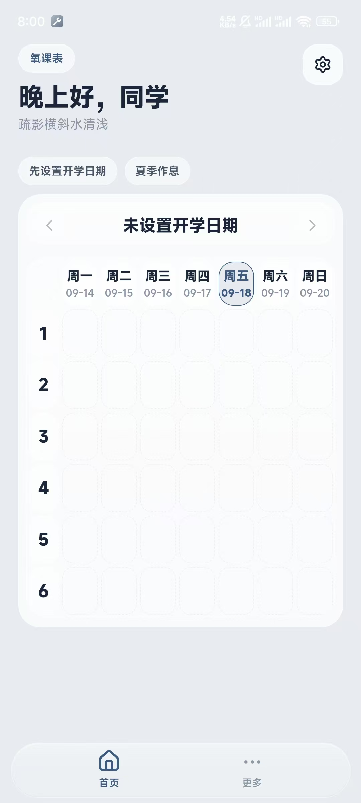
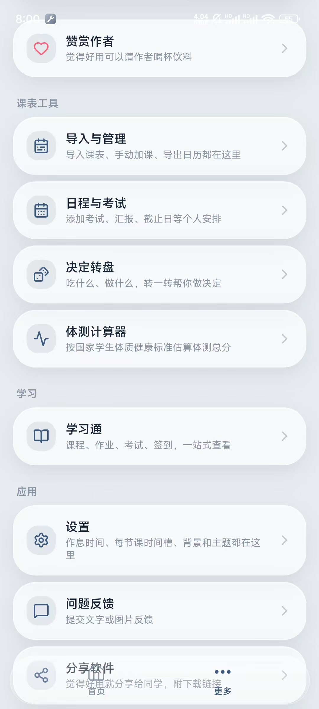
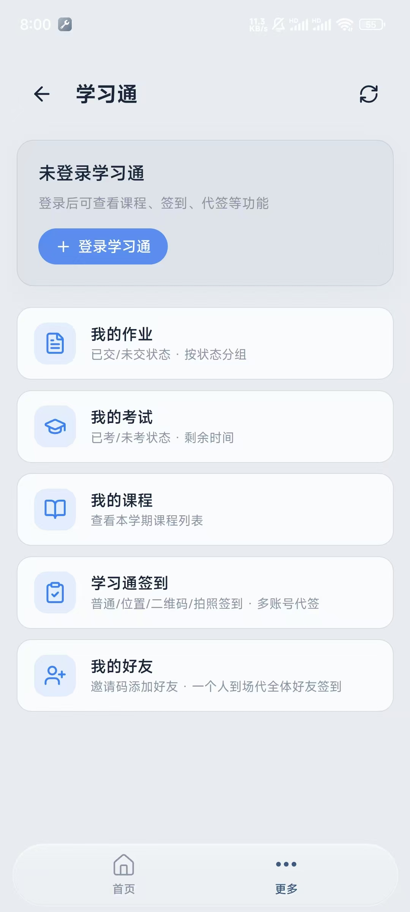

# 氧课表 Wake Up（Oxgeny）

**Wake Up 课表** —— 全高校通用的轻量课表 App：课表、成绩、考试、日程、体测测算一站式。
面向**全体大学生**，不管哪个学校都能用；无开屏广告，占用内存小，运行流畅。

> English: **Wake Up** timetable app for all college students — works with any university.
> Course schedule, grades, exams, schedule and fitness test score in one app.

> 在 GitHub 上搜**「Wake Up 课表」「WakeUp」「Wake Up timetable」「课表 App」「大学生课表」**，
> 出来的就是这个仓库 —— 不限学校，导入课表就能用。
>
> 如果你就是**安徽工业大学（安工大）**的同学，有专门为安工大做的版本：
> [**氢课表（安徽工业大学 · 安工大）**](https://github.com/xu20060420fan-cell/AHUT-timetable) —— 绑定学号即自动同步课表、考试、成绩与签到。

> 🆕 **V1.0.3 已发布**（V1.0.0 Compose 全新架构版的增量更新）
>
> 本版本是**用 Jetpack Compose 从零重写**的独立应用，**应用包名与 1.x 老版本不同**，
> 因此它**不会覆盖安装**老版本 —— 新旧两个可以并存，各用各的。
> 老版本（1.x）仍保留在下方历史 Release 里，按需下载。
> 已装 V1.0.0 / V1.0.1 / V1.0.2 的**不用重新下载**：App 每次打开会自动检查更新。
>
> ⚠ **升级到 V1.0.3 后，学习通需要重新登录一次** —— 登录态的保存方式改了（见下方更新内容第 1 条）。

---

## 下载

> **Wake Up 课表 · 大学生课表 · 全高校通用课表** —— 就是这个仓库。安徽工业大学的同学请看 [氢课表（安工大）](https://github.com/xu20060420fan-cell/AHUT-timetable)（绑定学号即自动同步）。

| 版本 | 架构 | 说明 | 下载 |
|---|---|---|---|
| **V1.0.3**（推荐） | Compose 重写 | App 内一键覆盖安装 · 学习通登录安全升级 | **[官网直链](https://xspirt.online/uploads/oxygen-schedule-v1.0.3-code10051.apk)** ｜ [GitHub Release](https://github.com/xu20060420fan-cell/WakeUp-timetable/releases/download/compose-v1.0.3/oxygen-schedule-v1.0.3.apk) ｜ [官网介绍页](https://xspirt.online/portal/home) |
| V1.0.2 | Compose 重写 | 学习通登录态首版 | [官网直链](https://xspirt.online/uploads/oxygen-schedule-v1.0.2-code10029.apk) |
| V1.0.1 | Compose 重写 | 新增无限金币档位 · 一号一邮箱 | [GitHub Release](https://github.com/xu20060420fan-cell/WakeUp-timetable/releases/download/compose-v1.0.1/oxygen-schedule-v1.0.1.apk) |
| V1.0.0 | Compose 重写 | 功能与体验全面升级 | [GitHub Release](https://github.com/xu20060420fan-cell/WakeUp-timetable/releases/download/compose-v1.0.0/oxygen-schedule-v1.0.0.apk) |
| 1.0.17 | 原生老架构 | 旧版本，已停止功能更新 | [GitHub Release](https://github.com/xu20060420fan-cell/WakeUp-timetable/releases/download/v1.0.17/oxygen-schedule-release.apk) |

> ℹ️ **国内下载建议走官网直链。** GitHub 的安装包下载走的是 GitHub 自己的 CDN，
> 在大陆线路常常很慢甚至连不上；官网是服务器直连，最快也最稳。

- 下载的是**免安装单文件 APK**，下载后点开即用；首次运行若被系统拦截，点「更多信息 → 仍要运行」。
- App 每次打开会自动检查更新，收到新版本提示按提示更新即可。
- **官网**：<https://xspirt.online> —— 除了下载，官网还提供**晚寝签到**、**学习通签到**等
  **直接在网页上就能用**的在线服务，不装 App 也能用。
- 域名解析不了时，可以用**直链下载页**：<https://xspirt.online/dl/>

---

## 界面预览

| 首页 · 今日课表 | 更多 | 学习通 |
|:---:|:---:|:---:|
|  |  |  |

---

## 核心功能

1. **截图导入课表** —— 上传教务课表截图给豆包解析，复制结果即可一键导入课程，不用手动逐条录入。
2. **今日首页视图** —— 展示当日课程，上完课程自动置灰，无课时界面干净；支持手动添加自定义日程。
3. **周课表** —— 7 天网格 + 大节时间槽，左右滑动切周，点空白格加课。
4. **节数与作息全可配** —— 大节数、每节起止时间均可在设置里自由调整；导入课表时**以导入文件自带的作息为准**，不用先手动设置。
5. **课程颜色自动分配** —— 同名课程永远同色，导入与手动加课统一处理。
6. **成绩与考试查询** —— 按学期查成绩、绩点与学分；考试科目分「未考 / 已考」展示时间、考场与座位号。
7. **体测计算器** —— 按《国家学生体质健康标准》计算总分。
8. **自定义背景 / Dock 透明度 / 小组件透明度 / 冬夏作息自动切换**；自定义壁纸后「莫奈取色」也会重新生效。
9. **桌面小组件** —— 上课中会动态显示「下课时间」，不用回 App 看。
10. **学期设置** —— 在「设置 → 学期设置」填开学日期与学期周数，不再显示猜出来的「第几周」。
11. **课表导出** —— 导出 ICS 导入系统日历；可直接「保存到文件」自己选位置。
12. **日程与考试** —— 支持手动添加日程与考试安排。
13. **学习通刷课助手** —— 配套的油猴脚本与浏览器扩展，在学习通网页上直接用，不用进 App。

---

## V1.0.3 更新内容

1. **App 内可直接下载并覆盖安装新版本**：更新页点「下载并安装」即可 —— 不用跳浏览器、不用手动找下载目录，**也不用卸载重装**（课表、账号、壁纸全部保留）。没装「安装未知应用」权限时会先带你去系统设置授权。
2. **更新检查会带上你当前的版本号**：已经是最新版时不再误报「有更新」。
3. **学习通登录改为「学号 + 会话令牌」**：服务器不再只凭学号认人，登录成功后会发一枚一次性令牌，App 按学号存在本地。**这也是本版本需要重新登录一次学习通的原因** —— 旧版本保存的令牌格式变了。
2. **修复学习通整片 404**：此前 App 拿到的服务器地址会把路径前缀丢掉，导致学习通相关的课程、成绩、活动接口全部拉不出来。现在地址前缀会正确保留。
3. **退出登录 / 删除账号时一并清掉学习通令牌**，不在手机里留残余。
4. **令牌失效会被自动识别并清理**：不会拿着一个永远用不了的令牌反复重试，界面直接提示「请重新登录学习通」。
5. **备份时学习通令牌按敏感字段加密保存**，不会被当成普通配置丢在明文里。
6. **服务器侧同步加固**：管理密钥换成 64 位随机值、源码里不再保留默认口令明文、账号列表现在只显示你自己的。

## V1.0.1 更新内容

1. **新增「无限金币」档位**：由管理员按学号或姓名开通后，账号永久拥有无限金币 —— 签到不再涨币，用金币的功能（如代签到等）也不扣分。
2. 无限金币账号不再强制先绑定邮箱，直接就能用需要金币的功能。
3. 签到页金币区会直接显示「无限金币」字样。
4. 服务器后台新增「高级设置」页（邮件通知内容可自定义、金币档位按学号/姓名管理、下载限流配额）。
5. 邮箱改为「一号一邮箱」：换绑会自动解开旧绑定并通知旧邮箱主人；邮箱已被别人占用时会明确拒绝并提示。
6. 服务器加强了下载限流与流量保护。

## V1.0.0 更新内容

1. 桌面小组件（2×2）上课后会显示「下课时间」，不再一直显示上课时间；周课表上课中的格子显示「至 09:40」。
2. 「我的课程」补上课程封面图与学习通账号头像（此前一律显示固定图标）。
3. 新增「设置 → 学期设置」入口：填开学日期与学期周数，不再固定显示「共 22 周 / 第 8 周」。
4. 导入课表时以导入文件里的上课时间为准，不用先去手动设置作息。
5. 导出 ICS 新增「保存 ICS 到文件（自己选位置）」，并写清导入系统日历的三步路径。
6. 自定义壁纸后「莫奈取色」重新生效（换壁纸 / 移除壁纸 / 恢复备份后都会重取色）。
7. 学习通 / 考试 / 课表 / 周课表底部补了留白，最后一条内容不再被底栏压住。
8. 设置里的滑条不再贴着卡片右边缘。

---

## 关于

- **适用人群**：**面向全体大学生**的通用课表 App（Wake Up 课表），不限学校，导入课表即可用；安徽工业大学（安工大）的同学有专门版：[氢课表（安徽工业大学 · 安工大）](https://github.com/xu20060420fan-cell/AHUT-timetable)。
- **官网**：<https://xspirt.online> —— 软件下载、晚寝签到、学习通签到、教程与公告都在这里。
- **在线使用**：不想装 App 也可以，官网的签到服务直接在浏览器里用。
- **GitHub**：<https://github.com/xu20060420fan-cell> —— 本项目及其它开源工具都在这里。
- **QQ**：210864381

---

## 许可

仅供个人学习与本机维护使用。本仓库只发布安装包与说明文档，不包含应用源码。
